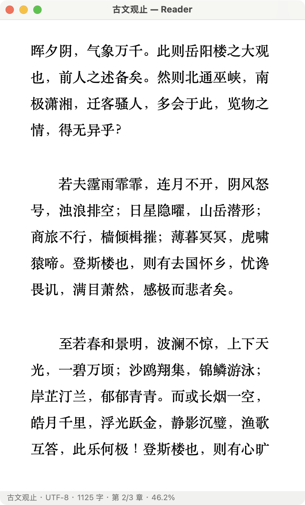
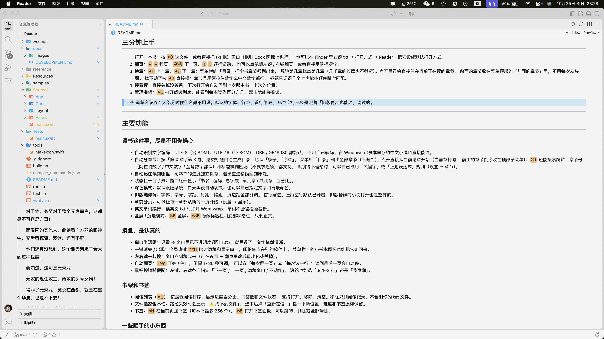

# Reader for Mac

Reader 是一个为 macOS 写的本地阅读器。打开一个 txt，它自动分好章节、排好版，
下次打开还接着上次的位置；界面想怎么调就怎么调，不想被人看见时一键就能藏起来。

不注册、不联网、没有广告，所有东西都留在你自己的电脑上。

> 它源自 Windows 上那款很受欢迎的免费阅读器 [binbyu/Reader](https://github.com/binbyu/Reader)，
> 这一版是用 macOS 原生代码重写的，操作和外观更贴合 Mac，
> 同时**阅读记录（存档）和 Windows 版通用**，书架、进度、书签都能带过来。

## 目录

- [界面](#界面)
- [装到电脑上](#装到电脑上)
- [三分钟上手](#三分钟上手)
- [主要功能](#主要功能)
- [快捷键速查](#快捷键速查)
- [你的阅读数据在哪](#你的阅读数据在哪)
- [常见问题](#常见问题)
- [关于 Reader](#关于-reader)

---

## 界面

<p align="center">
  
</p>

<p align="center">
  
  <br>
  <sub>摸鱼模式：窗口调成半透明浮在别的软件上面 —— 背景透了，文字依然是清楚的</sub>
</p>

---

## 装到电脑上

**能跑的电脑**：macOS 13 及以上 + Apple 芯片（M1 / M2 / M3 / M4…）。
目前还不支持 Intel 芯片的 Mac。

### 直接下载（推荐）

[**↓ 下载 Reader 0.2.1**](https://github.com/LeeeZH/Reader-macOS/releases/latest/download/Reader-0.2.1-macos-arm64.zip)

1. 解压 zip，得到 `Reader.app`
2. 把它拖进「应用程序」文件夹
3. **第一次打开请右键点 `Reader.app` → 选择「打开」** —— 本版没有做 Apple 公证，
   直接双击会被系统拦下。之后就能正常双击启动了。

如果系统提示「已损坏」或者你不想每次都右键，执行一次：

```bash
xattr -dr com.apple.quarantine /Applications/Reader.app
```

### 或者自己编译

只要装过 Xcode 命令行工具就行（零第三方依赖）：

```bash
# 1. 装编译工具（只需一次，装过会跳过）
xcode-select --install

# 2. 在项目目录里编译
./build.sh

# 3. 把 dist/Reader.app 拖进「应用程序」文件夹，双击打开
```

> 没有 txt 也可以先试：`samples/` 目录里有一本样书《古文观止》
> （`古文观止.txt`，另附 GBK 编码版 `古文观止-GBK.txt`），拖进窗口就能读。

---

## 三分钟上手

1. **打开一本书**：按 `⌘O` 选文件，或者直接把 txt 拖进窗口（拖到 Dock 图标上也行）。
   也可以在 Finder 里右键 txt → 打开方式 → Reader，把它设成默认打开方式。
2. **翻页**：`←` `→` 翻页，`空格` 下一页，`↑` `↓` 逐行滚动。
   也可以点鼠标左键 / 右键翻页，或者直接用鼠标滚轮。
3. **换章**：`⌘↑` 上一章、`⌘↓` 下一章；菜单栏的「目录」把全书章节都列出来，
   想跳第几章就点第几章（几千章的长篇也不截断）。点开目录会直接停在**当前正在读的章节**，
   前面的章节收在菜单顶部的「前面的章节」里，不用每次从头翻。
   找不动了按 `⌘J` 直接搜：章节号用阿拉伯数字或中文数字都行，
   标题只记得几个字也能按顺序跳字匹配。
   想找正文里的一句话，按 `⌘F`（全文搜索），双击结果或点「跳转」跳过去。
4. **接着读**：直接关掉没关系，下次打开会自动回到上次那本书、上次的位置。
5. **管理书架**：`⌘L` 打开阅读列表，能看到每本读到百分之几，双击就能接着读。

> 不知道怎么设置？大部分时候**什么都不用设**。默认的字体、行距、首行缩进、
> 压缩空行已经是照着「排版再乱也能读」调过的。

---

## 主要功能

### 读书这件事，尽量不用你操心

- **自动识别文字编码**：UTF-8（含 BOM）、UTF-16（带 BOM）、GBK / GB18030 都能认，
  不用自己转码。在 Windows 记事本里存的中文小说也直接能读。
- **自动分章节**：按「第 X 章 / 第 X 卷」这类标题自动生成目录，也认「楔子」「序章」。
  菜单栏「目录」列出**全部章节**（不截断），点开直接从当前这章开始（当前章打勾，
  前面的章节倒序收在顶部子菜单）；`⌘J` 还能搜索跳转：章节号（阿拉伯数字 /
  中文数字 / 全角数字都认）和标题模糊匹配（不要求连续）都支持。
  识别得不理想时，可以自己改用「关键字」或「正则表达式」规则（设置 → 章节）。
- **全文搜索**（`⌘F`）：一次扫完整本书，列出每一处所在的章节和前后文。
  搜索**不会自己跳页** —— 双击结果、按回车或点「跳转」才跳过去，`⌘G` / `⇧⌘G` 前后翻；
  当前页上的命中会高亮。关掉面板会清掉高亮和输入框，下次打开是干净的一次查找。
  纯本地匹配、不需要联网。
  （一处命中就是一个字符位置，所以「本次读到哪」不会因为搜索而错乱。）
- **自动记住读到哪里**：每本书的进度独立保存，退出重进精确回到原处。
- **状态栏一目了然**：窗口底部显示「书名 · 编码 · 总字数 · 第几章 / 共几章 · 百分比」。
- **深色模式**：默认跟随系统，白天黑夜自动切换；也可以自己指定文字和背景颜色。
- **排版随你调**：字体、字号、字距、行距、段距、页边距全都能调。
  首行缩进、压缩空行默认已开启，排版稀碎的小说打开也是整齐的。
- **章节标题可以单独设字体**：默认和正文同字体同色；想区分开就在设置 → 显示 →
  章节标题里取消「同一字体和颜色」，给标题单独挑字体、字号、颜色（存的是原版
  `.cache.dat` 的 `use_same_font` / `font_title`，Windows 版存档过来直接生效）。
- **章前分页**：可以让每一章都从新的一页开始（设置 → 显示）。
- **背景图片**：设置 → 显示 → 背景图片里选一张图当底，三种铺法：拉伸铺满、平铺、
  平铺翻转（相邻瓦片镜像）。纯色在底下、图片铺在上面，窗口调半透明时图片跟着淡、
  **文字始终清晰**；图片文件被删掉了就自动退回纯色，并在设置里标红提示，不会弹窗。
- **英文单词换行**：读英文 txt 时打开 Word wrap，单词不会被拦腰截断。
- **全屏 / 沉浸模式**：`⌃⌘F` 全屏；`⇧⌘B` 隐藏标题栏和底部状态栏，只剩正文。

### 摸鱼，是认真的

- **窗口半透明**：设置 → 窗口里把不透明度调到 10%，背景透了，**文字依然清晰**。
- **窗口置顶**（`⌃⌘T`）：勾上「窗口置顶」（**菜单「视图 → 窗口置顶」**、快捷键 `⌃⌘T`、
  右上角菜单栏图标的菜单，或 设置 → 窗口，几处是同一个开关），Reader 就浮在其它应用上面 ——
  点别的软件、把那边窗口最大化，都挡不住它。焦点在别的软件里时，
  鼠标滚轮停在 Reader 上照样能翻页，不用点回来。
  （只覆盖普通 / 最大化窗口；别人按绿色按钮进的原生全屏盖不住 —— 那是独立桌面，
  要硬盖属于系统没承诺的做法，没做。打开设置 / 书架这些窗口时，阅读窗口会临时
  回到普通层级，关掉后自动恢复置顶。）
- **一键消失 / 出现**：全局热键 `⌃⌥H` 随时隐藏和显示窗口，哪怕焦点在别的软件上。
  菜单栏上的小书本图标也能把它叫回来。
- **左右键一起按**：窗口立刻藏起来（可在设置 → 翻页里改成最小化或关掉）。
- **自动翻页**：`⇧⌘A` 开始 / 停止，间隔 1~30 秒可调，
  可以选「每次翻一页」或「每次滚一行」；读到最后一页会自动停。
- **鼠标按键随便配**：左键、右键各自指定「下一页 / 上一页 / 隐藏窗口 / 不动作」，
  滚轮也能选「滚 1~3 行」还是「整页翻」。

### 书架和书签

- **阅读列表**（`⌘L`）：按最近阅读排序，显示进度百分比、书签数和文件状态，
  支持打开、移除、清空。移除只删阅读记录，**不会删你的 txt 文件**。
- **文件搬家也不怕**：路径失效时会显示「⚠️ 找不到文件」，
  选中后点「重新定位…」指一下新位置，**进度和书签原样保留**。
- **书签**：`⌘D` 在当前页加书签（每本书最多 256 个），
  `⌘B` 打开书签面板，可以跳转、删除或全部清除。

### 一些顺手的小东西

- **编辑模式** `⌘E`：想改个错字、删掉文中的广告，直接改。
  退出时会问你要不要保存，保存时按原文件的编码写回。
- **取色器**：调文字 / 背景颜色时可以直接吸屏幕上的颜色。
- **触控栏**：带 Touch Bar 的 MacBook Pro 上，翻页、进度、换章、书签、字号都在手边，
  长尾操作收在两侧的小面板里。没有触控栏的机型完全不受影响。
- **快捷键都能自己改**：设置 → 快捷键里点一下某个功能，**现场按键**就改好了；
  和已有键位冲突时（包括点「还原」会让默认键位撞车），**窗口底部固定提示条**会写明
  「哪个键被哪个功能占用」，并给你「交换 / 取消」两个选择（切标签页不会丢，
  关掉设置即放弃）；每行单独的「还原」、
  底部「全部还原默认」。快捷键页里显示**全称**（`command + F`）方便认键；
  菜单、状态栏和各处提示沿用 macOS 习惯显示**图标**（`⌘F`）。
- **拖拽打开**：txt 拖进窗口或 Dock 图标就能读。
- **多窗口**：阅读列表、书签、设置都是独立窗口，可以并排摆着用。

---

## 快捷键速查

Windows 上的 `Ctrl` 在 Mac 上基本换成 `⌘`，习惯一下就好。
**下面这一整张表都可以在 设置 → 快捷键 里改**（点一下就地录制）。
系统标准键 `⌘Q` / `⌘W` / `⌘H` / `⌘M`（最小化）固定不变。

| 操作 | 快捷键 |
|---|---|
| 打开文件 | `⌘O` |
| 阅读列表（书架） | `⌘L` |
| 上一页 / 下一页 | `←` `→`（可改；`PageUp` `PageDown` `空格` 是固定的辅助键） |
| 逐行上滚 / 下滚 | `↑` `↓` |
| 上一章 / 下一章 | `⌘↑` `⌘↓` |
| 目录 | 菜单「目录」（列出全部章节） |
| 搜索 / 跳转章节 | `⌘J`（章节号或标题关键词） |
| 全文搜索 | `⌘F` |
| 查找下一个 / 上一个 | `⌘G` / `⇧⌘G` |
| 添加书签 / 书签面板 | `⌘D` / `⌘B` |
| 放大 / 缩小字号 | `⌘=` / `⌘-` |
| 编辑模式 | `⌘E` |
| 自动翻页开 / 关 | `⇧⌘A` |
| 沉浸模式（隐藏顶栏底栏） | `⇧⌘B` |
| 窗口置顶开 / 关 | `⌃⌘T` |
| 进入 / 退出全屏 | `⌃⌘F` |
| 打开设置 | `⌘,` |
| 在访达中显示存档 | `⇧⌘S` |
| **隐藏 / 显示窗口（全局）** | `⌃⌥H` |

> 全局热键和原版不同：Mac 上 `⌥H` 常被输入法占用，所以改成了 `⌃⌥H`。
> 不想要可以在 **设置 → 窗口** 里关掉。
>
> `⌘F` 是**查找正文**（和 macOS 上其他软件一致），全屏是 `⌃⌘F`。
> 旧版把 `⌘F` 当全屏用，现在改过来了 —— 第一次可能按错，习惯一下就好。
> 找章节用 `⌘J`（章节号或标题模糊搜索），找某一句话用 `⌘F`。

---

## 你的阅读数据在哪

**所有设置、书架、阅读进度、书签，都保存在同一个文件里：**

```
~/Library/Application Support/Reader/.cache.dat
```

注意：它存的是**书单、进度和书签**，不是书本身。
txt 文件还在你原来的位置，这个文件里只记了它的路径。

不用去 Finder 里一层层翻：菜单 **文件 → 在访达中显示存档**（`⇧⌘S`）就能直接定位到它。

几个常见需求：

| 我想…… | 怎么做 |
|---|---|
| 备份 / 换新电脑 | 菜单 文件 → **导出存档…**，把文件收好；新电脑装好 Reader 后，用 ⇧⌘S 找到存档位置放回去 |
| 搬到 Windows 版 Reader 上继续读 | 导出存档，把 `.cache.dat` 放到 Windows 版 exe 同目录 |
| 从 Windows 版搬过来 | 把原版 exe 同目录的 `.cache.dat` 放进 `~/Library/Application Support/Reader/` |
| 带着 U 盘 / 同步盘走 | 见下方「便携模式」 |
| 恢复默认设置 | 设置 → 其他 → **还原所有设置**（书架和进度不动） |
| 彻底清空 | 先用 文件 → 在访达中显示存档 定位，退出 Reader 后删掉那个文件 |

### 便携模式

把 `Reader.app` 放到 U 盘或同步盘，在它旁边建一个空文件，名字叫 `portable`，
阅读数据就会写在 App 旁边，换台电脑也能接着读。删掉 `portable` 就回到默认位置。

> 如果 App 所在位置不可写（比如直接在 DMG 里运行），会自动退回默认位置，
> 不会出现「设置保存不上」的情况。

```
/Volumes/我的U盘/Reader/
├── Reader.app
├── portable        ← 有这个文件 = 便携模式
└── .cache.dat      ← 自动生成
```

> 切换位置后是全新的数据。想把书架和进度带过去，
> 手动把旧位置的 `.cache.dat` 拷到新位置就行。

### 和 Windows 版互通

Mac 版和 Windows 版用的是**同一套存档格式**。所以：

- 从 Windows 换到 Mac：把 `.cache.dat` 放进去，书架、进度、书签、设置全都在；
- 从 Mac 带回 Windows：导出存档，放回 exe 同目录即可继续读。
- 阅读进度记录的是「读到全书的第几个字」，所以**即使文件换了位置**（比如从
  `D:\小说\a.txt` 变成 `/Users/你/Documents/a.txt`），进度依然对得上。

> Mac 版会多记几项界面偏好（平滑滚动、沉浸模式、菜单栏图标等）。这些项目
> Windows 版不认，在 Windows 上存一次盘后会回到默认值，但**书架、进度和书签不受影响**。

### 隐私

Reader 完全离线：不联网、不上传、不统计、没有自动更新。
除了你主动打开 / 保存的文件，它只会读写上面这一个存档文件；
系统还会自己记一份窗口位置的偏好设置，仅此而已。
存档万一读不出来，会先尝试把原文件备份一份，再从空白开始。

---

## 常见问题

**第一次打开提示「无法验证开发者」？**
在 Finder 里右键 `Reader.app` → 打开，再点一次「打开」。之后就能正常双击了。

**打开 txt 全是乱码？**
Reader 会自动识别 UTF-8、UTF-16（带 BOM）、GBK 等常见编码，正常情况下不用管。
如果还是乱码，说明文件用了不常见的编码：可以先用文本编辑器把它另存为 UTF-8，再重新打开。
仍然不行的话，把文件发给开发者排查。

**窗口被我藏起来了，怎么找回来？**
按全局热键 `⌃⌥H`，或点菜单栏上的小书本图标。也可以再点一次 Dock 里的 Reader 图标。

**书架里显示「⚠️ 找不到文件」？**
文件被移动或改名了。选中那本书 → 点「重新定位…」→ 指认新位置。
阅读进度和书签会原样保留。

**为什么我的书没有目录 / 章节分错了？**
说明默认规则没匹配上它的标题格式。到 **设置 → 章节** 改用「关键字」或「正则表达式」，
改完目录会立刻重新生成。

**想找书里的一句话，怎么找？**
按 `⌘F` 打开查找面板，输入原文里的几个字（默认不区分大小写），
列表会列出每一处所在的章节和前后文。**搜索不会自己跳页**：
双击结果行、按回车或点「跳转」才跳过去；`⌘G` / `⇧⌘G` 也能前后跳。
关掉面板会清空输入框、结果和页面上的高亮 —— 下次打开是干净的一次查找，
不会带着上次的词、也不会跳回上次的位置。阅读进度不受影响。
超过 2000 处时只会列出前面这些，提示里会写明。

**换电脑后书架空了？**
不会空。书架条目、进度、书签都在 `.cache.dat` 里，把它拷到新电脑的
`~/Library/Application Support/Reader/` 就行。但这个文件**不含 txt 本身**，
所以书也要一起拷过去，然后：

- txt 放在「文稿 / 下载 / 桌面」的话，打开阅读列表时会自动按文件名找回来；
- 放在别处的话，书会先标成「⚠️ 找不到文件」，选中后点「重新定位…」指一下即可，
  进度和书签不会丢。

阅读数据不会自动云同步，换设备就是手动搬一次；想省事可以用便携模式。

**能同步阅读进度吗？**
Reader 没有云同步，也刻意不联网。想换设备就手动搬一下存档。

**支持 EPUB / MOBI / 在线小说吗？**
暂时只支持 TXT。EPUB 仍押后，但前置的「书籍格式抽象」已经做完了
（阅读界面、书架、存档都面向统一的书接口，不是接个解析器就行），
还差零依赖的解压与 EPUB 专用排版；
**在线书源短期不做** —— 它会破坏「完全离线、不联网」这条底线，除非将来明确改产品方向；
MOBI 不考虑。计划与「明确不做」的清单见 [路线图](https://github.com/LeeeZH/Reader-macOS/blob/main/docs/ROADMAP.md)。

**Intel 芯片的 Mac 能用吗？**
暂时不行，目前只提供 Apple 芯片（arm64）版本。

**会不会偷偷联网、弹广告？**
不会。软件完全离线，代码开源，可以自己检查。

**怎么彻底卸载？**
退出 Reader，把 `Reader.app` 拖进废纸篓；如果想连阅读记录一起删，
再删掉 `~/Library/Application Support/Reader/.cache.dat`。

---

## 关于 Reader

- 本项目是 [binbyu/Reader](https://github.com/binbyu/Reader)（作者 Binbin Yu）的 macOS 重写版。
  阅读体验相关的部分（文字编码、文本排版、章节解析、存档格式）对齐原版，
  界面和 macOS 适配是重新实现的。感谢原作者。
- 原项目**没有 LICENSE 文件**，README 写明「所有版权归作者所有」「本软件严禁用于商业用途」。
  本项目沿用同样约定：**免费、开源，请勿用于商业用途**。分享请注明出处。
- 软件按「原样」提供，重要数据请自行备份。
- 有问题或建议，欢迎提 issue。
- 想自己改代码、了解实现细节：见 [开发笔记](https://github.com/LeeeZH/Reader-macOS/blob/main/docs/DEVELOPMENT.md)。
- 接下来打算做什么（以及明确「不做」什么）：见 [路线图](https://github.com/LeeeZH/Reader-macOS/blob/main/docs/ROADMAP.md)。

---

**Reader 0.2.1** · macOS 13+ · Apple 芯片（arm64）

[](https://github.com/deepseek-ai/deepseek-harness)
